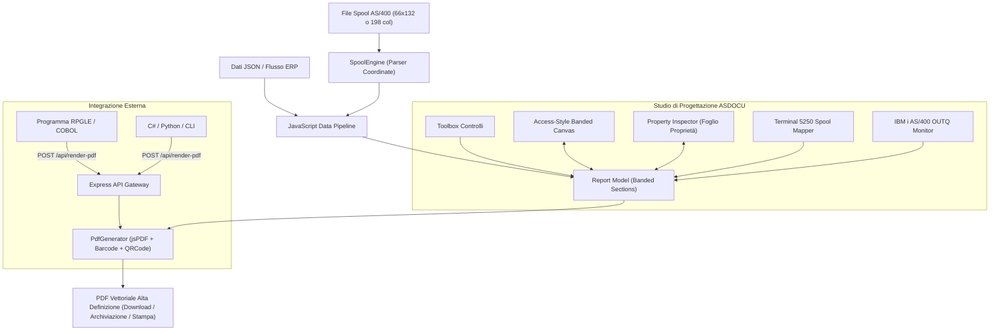

# ASDOCU 400 Studio 🚀
### AS/400 (IBM i) Spool-to-PDF Graphic Designer & Enterprise REST API Gateway

[](https://nodejs.org/)
[](https://vitejs.dev/)
[](https://www.ibm.com/it-it/it-infrastructure/power/os/ibm-i)
[](LICENSE)

**ASDOCU 400 Studio** è una suite professionale progettata per trasformare le stampe grezze **Spool AS/400 (IBM i, iSeries, Power Systems)** in documenti grafici PDF vettoriali di alta qualità (Fatture accompagnatorie, DDT, Ordini fornitore, Etichette logistiche con Barcode e QR-Code SDI).

L'applicazione unisce l'intuitiva interfaccia di **Microsoft Access Report Designer** (sezioni a bande: *Report Header, Page Header, Detail, Page Footer, Report Footer*) con un **Gateway API REST interattivo** richiamabile direttamente da programmi **RPGLE / CL / COBOL** o software esterni (**C#, Python, Node.js, cURL, ERP SAP**).

---

## 🌟 Caratteristiche Principali

- 📐 **Report Designer a Sezioni Stile MS Access**:
  - Sezioni a bande verticali ridimensionabili con colori dedicati.
  - Righelli millimetrici (mm) con snap magnetico su griglia configurabile.
  - Cassetta degli attrezzi completa: *Etichette testo fisso, Campi dati collegati a coordinate Spool `[Riga:Colonna]`, Tabelle ripetute, Barcode 1D (Code128, EAN13), QR Code 2D SDI, Riquadri/Cornici, Linee divisorie, Numerazione pagina*.
  - Foglio delle proprietà stile Access: schede *Formato*, *Dati (Spool)*, *Posizione (mm)* e *Tutto*.

- 🔌 **Hub di Connessione IBM i AS/400**:
  - Configurazione Host/IP, Porta, Utente, Password, Libreria e Coda di Stampa (OUTQ).
  - Supporto per **IBM i SQL Services (`QSYS2.SPOOLED_FILE_DATA`)**, SSH PASE (`CPYSPLF`) e TCP/IP FTP Spool Subsystem.
  - Browser in tempo reale dei file spool nella coda OUTQ (`QPRINT`, `QDDT`, `QORD`) con download immediato nel Designer o compilazione rapida in PDF.
  - Demone di monitoraggio automatico della coda (*OUTQ Watcher*).

- 📟 **Terminale IBM 5250 Green-Screen Spool Mapper**:
  - Visualizzatore autentico a fosfori verdi o ambra con righello di colonna 1-132 e numeri di riga.
  - Selezione visiva con il mouse del testo sullo spool con HUD di coordinate istantanee e pulsante per aggiungere il campo al report in un click.

- ⚡ **Pipeline Dati e Scripting JavaScript**:
  - Editor di codice integrato per eseguire script di trasformazione, ricalcolo imposte IVA e formattazione valuta prima della compilazione PDF.
  - Console di esecuzione in tempo reale che cattura i `console.log()` e ispettore ad albero JSON.

- 🔗 **Chiamata Interattiva da Programmi Esterni (API REST Gateway)**:
  - Endpoint `POST /api/render-pdf`: compila e restituisce PDF vettoriali come download binario (`application/pdf`), stringa Base64 o salvataggio su disco/IFS.
  - Codice pronto all'uso con esempi per **RPGLE (funzione nativa `QSYS2.HTTPPOSTCLOB`)**, **cURL / Shell**, **Python**, **C# / .NET**, **Node.js**.
  - Supporto per **URL Deep-Linking** nel browser: `http://localhost:5174/?action=print&template=fattura&spoolId=SPL008492`.

---

## 🏗️ Architettura del Sistema



---

## 🚀 Guida Rapida all'Installazione

### Prerequisiti
- **Node.js** v18 o superiore
- **npm** v9 o superiore

### 1. Clona il Repository
```bash
git clone https://github.com/KONECHOCO/ASDOCU-400.git
cd ASDOCU-400
```

### 2. Installa le Dipendenze
```bash
npm install --legacy-peer-deps
```

### 3. Avvia l'Interfaccia Web di Progettazione
```bash
npm run dev
```
Apri il browser su [http://localhost:5174/](http://localhost:5174/).

### 4. Avvia il Server API Gateway per Programmi Esterni
```bash
node server.js
```
Il server API REST risponderà su `http://localhost:3001/api`.

---

## 💻 Esempio di Chiamata da RPGLE su AS/400

Nel tuo programma RPGLE su IBM i, inserisci questa chiamata SQL per generare automaticamente il PDF subito dopo aver chiuso lo spool:

```rpgle
**FREE
ctl-opt dftactgrp(*no) actgrp(*caller);

dcl-s url           varchar(256);
dcl-s httpHeader    varchar(1000);
dcl-s httpBody      clob(1000000);
dcl-s httpResponse  clob(1000000);

// Endpoint ASDOCU 400 Studio
url = 'http://tuo-server:3001/api/render-pdf';

httpHeader = '<httpHeader><header name="Content-Type" value="application/json"/></httpHeader>';

httpBody = '{"template": "fattura",'
         + ' "spoolId": "SPL008492",'
         + ' "output": "file",'
         + ' "filename": "FA_2026_008492.pdf"}';

exec sql
  select responseMsg into :httpResponse
  from table(qsys2.httpPostClob(:url, :httpHeader, :httpBody));

if sqlcode = 0;
  dsply 'PDF Generato con Successo da ASDOCU!';
else;
  dsply 'Errore Chiamata ASDOCU';
endif;

*inlr = *on;
return;
```

---

## 📄 Licenza
Rilasciato sotto licenza MIT. Sviluppato per la modernizzazione documentale di IBM i / AS400.
